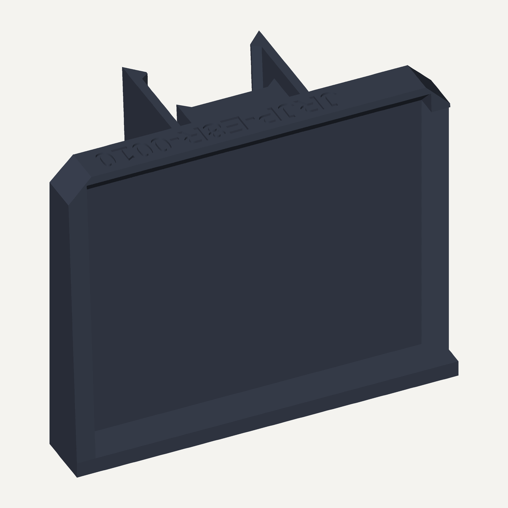

# Snap-on Receiver Rest for EVERSE 8 Handle

Snap-on rest that holds a Sennheiser EW-DP EK receiver on top of an Electro-Voice EVERSE 8 speaker's handle.



One-piece, no screws: a tray for a Sennheiser EW-DP EK receiver with a springy clip arm down each side of the EVERSE 8's top handle bar, running the tray's full length, each with a hook that snaps under the bar's bottom edge.

> Not yet test-printed in this exact version.

## Files

- `everse_clip_JRJP-E8R-0010.3mf` - 3MF (open in your slicer)
- `everse_clip_JRJP-E8R-0010.stl` - STL
- `everse_clip.py` - source
- `everse_clip_fit_test.py` - source
- `everse_rest.py` - source

## Print settings

- **Material:** PETG
- **Orientation:** as exported
- **Notes:** Designed on a Snapmaker U1; the 3MF opens in Bambu Studio, OrcaSlicer and PrusaSlicer.

## Serial number

Each print carries an engraved serial number (JRJP-E8R-0010). The `SERIAL` setting at the top of the source controls it.

## Changing it

The model is generated by the Python script with [build123d](https://github.com/gumyr/build123d). Edit the numbers at the top and run it:

```bash
pip install build123d trimesh
python everse_clip.py
```

## License

[Creative Commons Attribution-NonCommercial-ShareAlike 4.0](https://creativecommons.org/licenses/by-nc-sa/4.0/)
