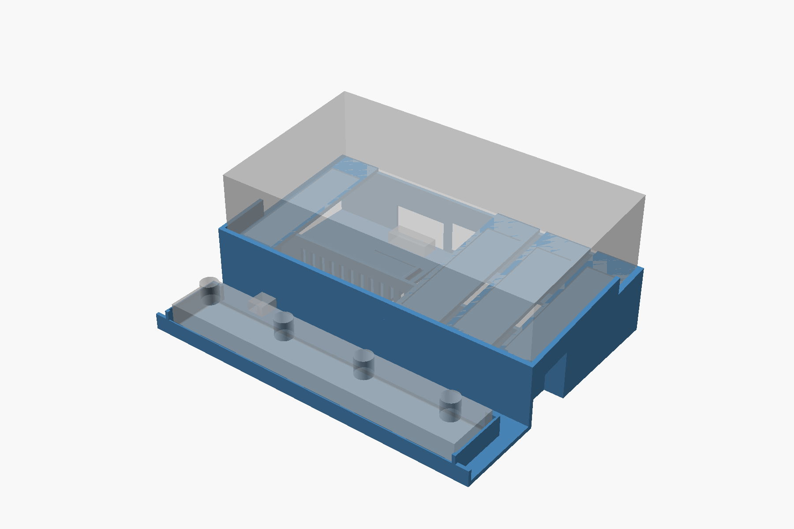

# Quad Cortex Mini Riser with Power Bank Bay

Riser for the Neural DSP Quad Cortex Mini that hides a UGREEN PB551 power bank underneath.

A one-piece riser that lifts and tilts a Neural DSP Quad Cortex Mini on a pedalboard, with a bay underneath for a UGREEN PB551 (20,000 mAh, built-in cable) power bank and a pocket in front for an M-VAVE Chocolate Plus MIDI pedal. OpenSCAD source: edit the numbers at the top of qc_mini_ribs_pb551.scad.

> Not yet test-printed in this exact version.

## Files

- `ribs_pb551_frame_JRJP-QCR-551-0004.3mf` - 3MF (open in your slicer)
- `ribs_pb551_frame_JRJP-QCR-551-0004.stl` - STL
- `qc_mini_ribs.scad` - source
- `qc_mini_ribs_pb551.scad` - source

## Print settings

- **Material:** PETG
- **Orientation:** as exported
- **Notes:** Designed on a Snapmaker U1; the 3MF opens in Bambu Studio, OrcaSlicer and PrusaSlicer.

## Serial number

Each print carries an engraved serial number (JRJP-QCR-551-0004). The `SERIAL` setting at the top of the source controls it.

## Changing it

Open the `.scad` file in [OpenSCAD](https://openscad.org), edit the numbers at the top, render (F6) and export.

## License

[Creative Commons Attribution-NonCommercial-ShareAlike 4.0](https://creativecommons.org/licenses/by-nc-sa/4.0/)
