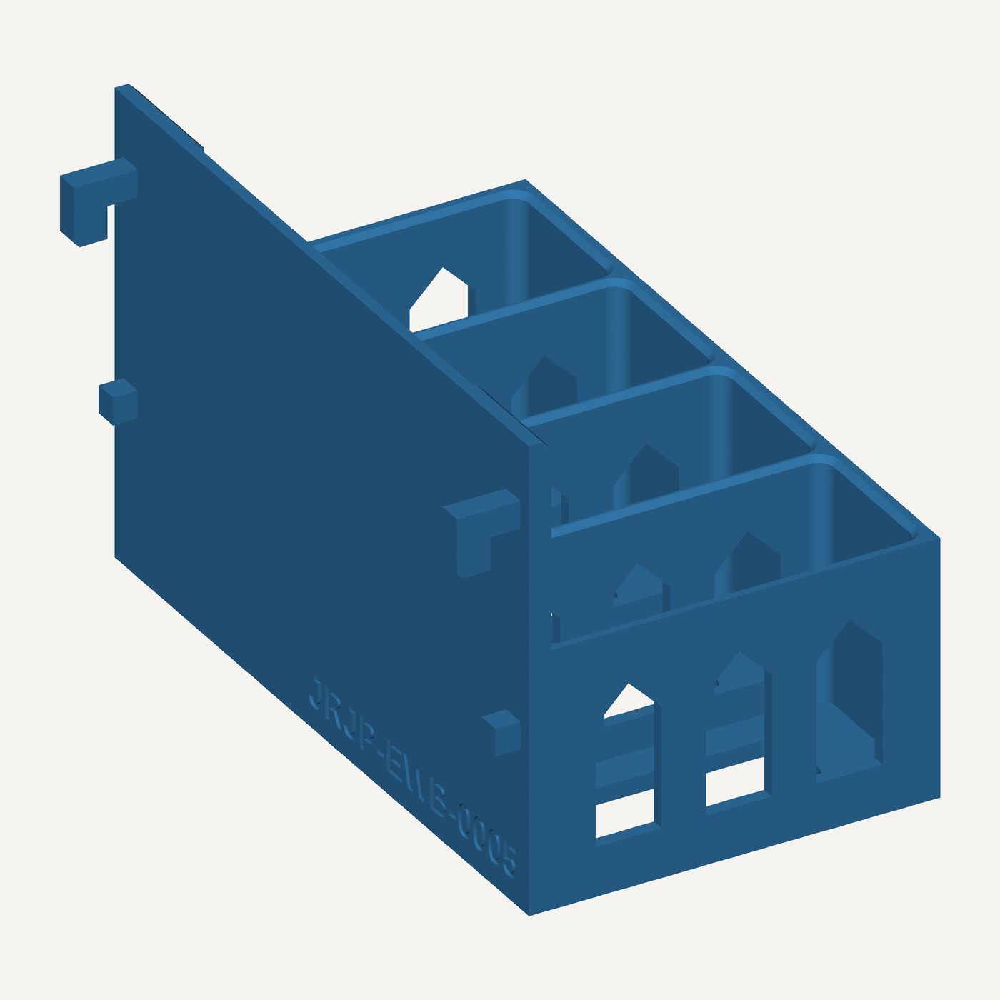

# EW-D Bodypack SKÅDIS Holder (MIC 1-4)

SKÅDIS holder for four Sennheiser EW-D / EW G4 bodypacks side by side, labelled MIC 1-4.



SKÅDIS holder for four Sennheiser EW-D / EW G4 bodypacks side by side, labelled MIC 1-4. Its twin, labelled MIC 5-8, is published separately.

> Not yet test-printed in this exact version.

## Files

- `ewd_bodypack_holder_1-4_JRJP-EWB-0005.3mf` - 3MF (open in your slicer)
- `ewd_bodypack_holder_1-4_JRJP-EWB-0005.stl` - STL
- `ewd_bodypack_holder_1-4.py` - source

## Print settings

- **Material:** PETG
- **Supports:** tree, build plate only (already set in the 3MF)
- **Orientation:** as exported
- **Notes:** Designed on a Snapmaker U1; the 3MF opens in Bambu Studio, OrcaSlicer and PrusaSlicer.

## Serial number

Each print carries an engraved serial number (JRJP-EWB-0005). The `SERIAL` setting at the top of the source controls it.

## Changing it

The model is generated by the Python script with [build123d](https://github.com/gumyr/build123d). Edit the numbers at the top and run it:

```bash
pip install build123d trimesh
python ewd_bodypack_holder_1-4.py
```

## License

[Creative Commons Attribution-NonCommercial-ShareAlike 4.0](https://creativecommons.org/licenses/by-nc-sa/4.0/)
