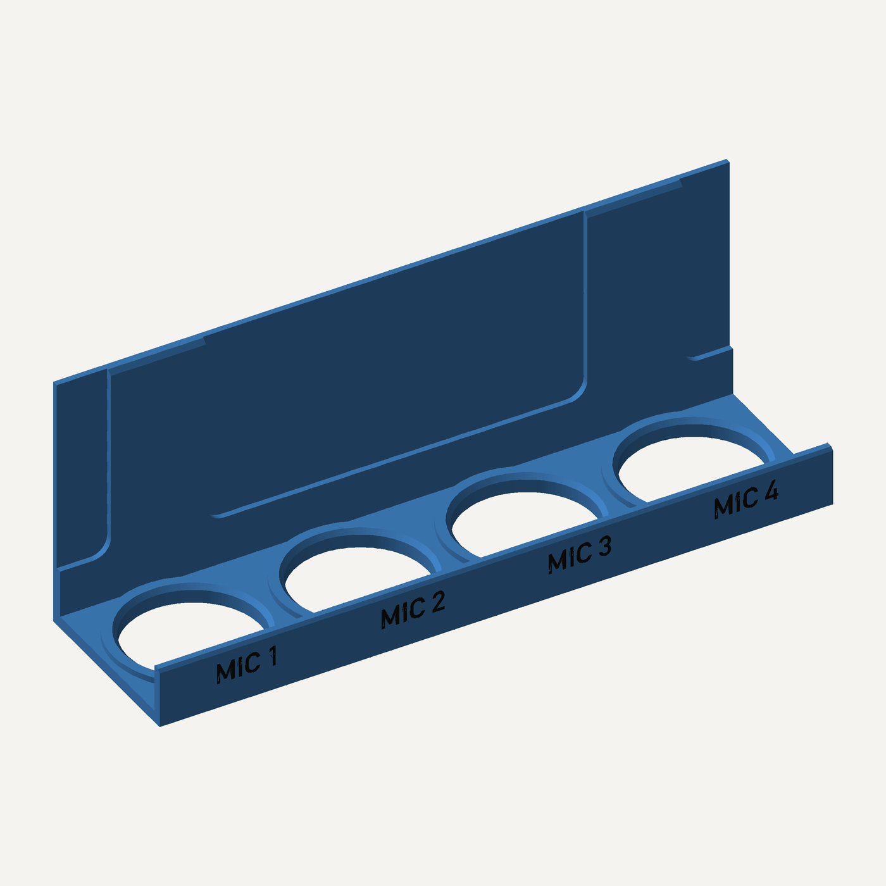

# EW-D Handheld SKÅDIS Holder

SKÅDIS holder for four Sennheiser EW-D / EW G4 handheld mics, hanging head-up side by side, labelled MIC 1-4 like the bodypack holder, the Wireless Caddy and the cable tags.



SKÅDIS holder for four Sennheiser EW-D / EW G4 handheld mics, hanging head-up side by side, labelled MIC 1-4 like the bodypack holder, the Wireless Caddy and the cable tags. Its partner for four bodypacks is in ../EW-D Bodypack Skadis Holder.

> Not yet test-printed in this exact version.

## Files

- `ewd_handheld_holder_JRJP-EWM-0002.3mf` - 3MF (open in your slicer)
- `parts/ewd_handheld_holder_JRJP-EWM-0002_body.stl` - STL
- `parts/ewd_handheld_holder_JRJP-EWM-0002_labels.stl` - STL
- `ewd_handheld_holder.py` - source
- `ewd_handheld_holder_fit_test.py` - source
- `ewd_handheld_holder_ring_fit_test.py` - source

## Print settings

- **Material:** PETG
- **Supports:** tree, build plate only (already set in the 3MF)
- **Orientation:** as exported
- **Notes:** Designed on a Snapmaker U1; the 3MF opens in Bambu Studio, OrcaSlicer and PrusaSlicer.

## Serial number

Each print carries an engraved serial number (JRJP-EWM-0002). The `SERIAL` setting at the top of the source controls it.

## Changing it

The model is generated by the Python script with [build123d](https://github.com/gumyr/build123d). Edit the numbers at the top and run it:

```bash
pip install build123d trimesh
python ewd_handheld_holder.py
```

## License

[Creative Commons Attribution-NonCommercial-ShareAlike 4.0](https://creativecommons.org/licenses/by-nc-sa/4.0/)
