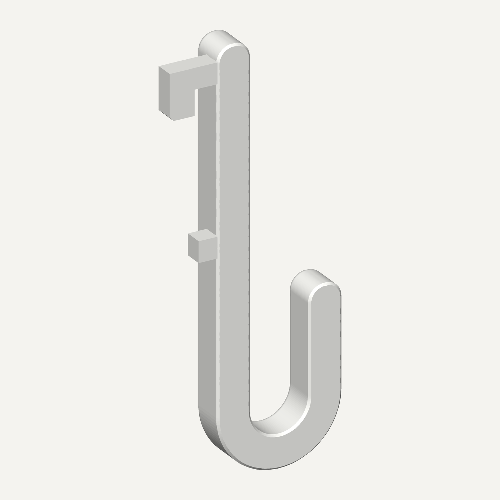

# SKÅDIS Rounded J Hook

SKÅDIS rounded J-hook, modelled on IKEA's white plastic SKÅDIS hook 203.208.02 (sold as a 5-pack; this is ONE hook, print it once per hook you want): the chunkier, soft-edged cousin of the J Hook (IKEA's black wire one), for keys, headphones, bags and cables.



> Not yet test-printed in this exact version.

## Files

- `rounded_j_hook_JRJP-RJH-0001.3mf` - 3MF (open in your slicer)
- `rounded_j_hook_JRJP-RJH-0001.stl` - STL
- `rounded_j_hook.py` - source

## Print settings

- **Material:** PETG
- **Supports:** tree, build plate only (already set in the 3MF)
- **Orientation:** as exported
- **Notes:** Designed on a Snapmaker U1; the 3MF opens in Bambu Studio, OrcaSlicer and PrusaSlicer.

## Serial number

Each print carries an engraved serial number (JRJP-RJH-0001). The `SERIAL` setting at the top of the source controls it.

## Changing it

The model is generated by the Python script with [build123d](https://github.com/gumyr/build123d). Edit the numbers at the top and run it:

```bash
pip install build123d trimesh
python rounded_j_hook.py
```

## License

[Creative Commons Attribution-NonCommercial-ShareAlike 4.0](https://creativecommons.org/licenses/by-nc-sa/4.0/)
