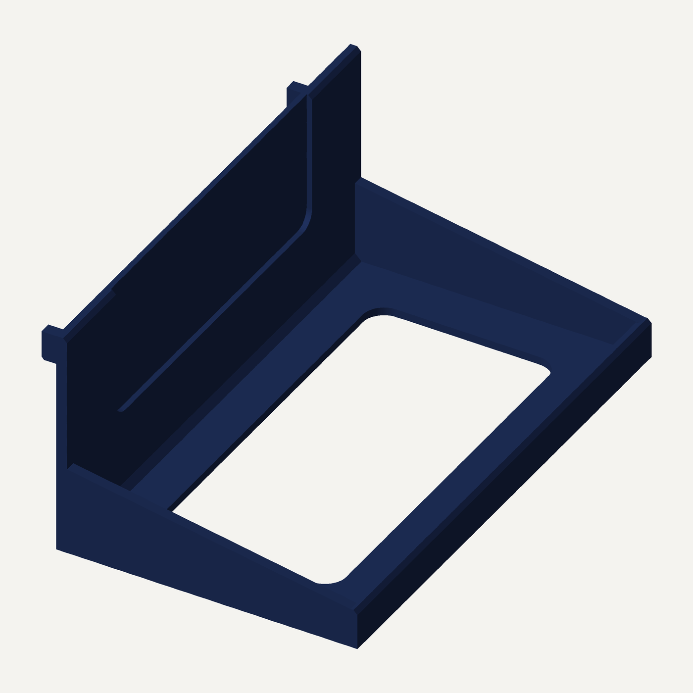

# MC6 Pro SKÅDIS Holder

Two ways to store a Morningstar MC6 PRO on SKÅDIS: a stand that holds it on its front edge, leaning back with the footswitches facing into the room (mc6pro_buttons_out_holder), and a flat shelf (mc6pro_holder).



> Not yet test-printed in this exact version.

## Files

- `mc6pro_buttons_out_holder_JRJP-MSH-0004.3mf` - 3MF (open in your slicer)
- `mc6pro_buttons_out_holder_JRJP-MSH-0004.stl` - STL
- `mc6pro_holder_JRJP-MSH-0002.3mf` - 3MF (open in your slicer)
- `mc6pro_holder_JRJP-MSH-0002.stl` - STL
- `mc6pro_buttons_out_holder.py` - source
- `mc6pro_holder.py` - source

## Print settings

- **Material:** PETG
- **Supports:** tree, build plate only (already set in the 3MF)
- **Orientation:** as exported
- **Notes:** Designed on a Snapmaker U1; the 3MF opens in Bambu Studio, OrcaSlicer and PrusaSlicer.

## Serial number

Each print carries an engraved serial number (JRJP-MSH-0002, JRJP-MSH-0004). The `SERIAL` setting at the top of the source controls it.

## Changing it

The model is generated by the Python script with [build123d](https://github.com/gumyr/build123d). Edit the numbers at the top and run it:

```bash
pip install build123d trimesh
python mc6pro_buttons_out_holder.py
```

## License

[Creative Commons Attribution-NonCommercial-ShareAlike 4.0](https://creativecommons.org/licenses/by-nc-sa/4.0/)
