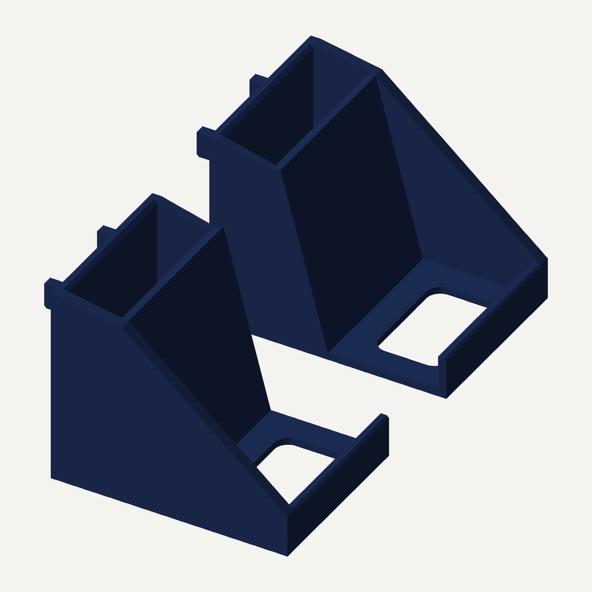

# MPK Mini SKÅDIS Holder

SKÅDIS brackets for storing an Akai MPK Mini MK4 upright: standing on its back (USB) edge, keys pointing up, playing surface facing the room.



SKÅDIS brackets for storing an Akai MPK Mini MK4 upright: standing on its back (USB) edge, keys pointing up, playing surface facing the room. A left and a right bracket each hold one end of it, each printed on its own (together on one plate, the nozzle strings across the gap between them).

> Not yet test-printed in this exact version.

## Files

- `mpk_mini_holder_L_JRJP-MPK-L-0001.3mf` - 3MF (open in your slicer)
- `mpk_mini_holder_L_JRJP-MPK-L-0001.stl` - STL
- `mpk_mini_holder_R_JRJP-MPK-R-0001.3mf` - 3MF (open in your slicer)
- `mpk_mini_holder_R_JRJP-MPK-R-0001.stl` - STL
- `mpk_mini_holder.py` - source

## Print settings

- **Material:** PETG
- **Supports:** tree, build plate only (already set in the 3MF)
- **Orientation:** as exported
- **Notes:** Designed on a Snapmaker U1; the 3MF opens in Bambu Studio, OrcaSlicer and PrusaSlicer.

## Serial number

Each print carries an engraved serial number (JRJP-MPK-L-0001, JRJP-MPK-R-0001). The `SERIAL` setting at the top of the source controls it.

## Changing it

The model is generated by the Python script with [build123d](https://github.com/gumyr/build123d). Edit the numbers at the top and run it:

```bash
pip install build123d trimesh
python mpk_mini_holder.py
```

## License

[Creative Commons Attribution-NonCommercial-ShareAlike 4.0](https://creativecommons.org/licenses/by-nc-sa/4.0/)
