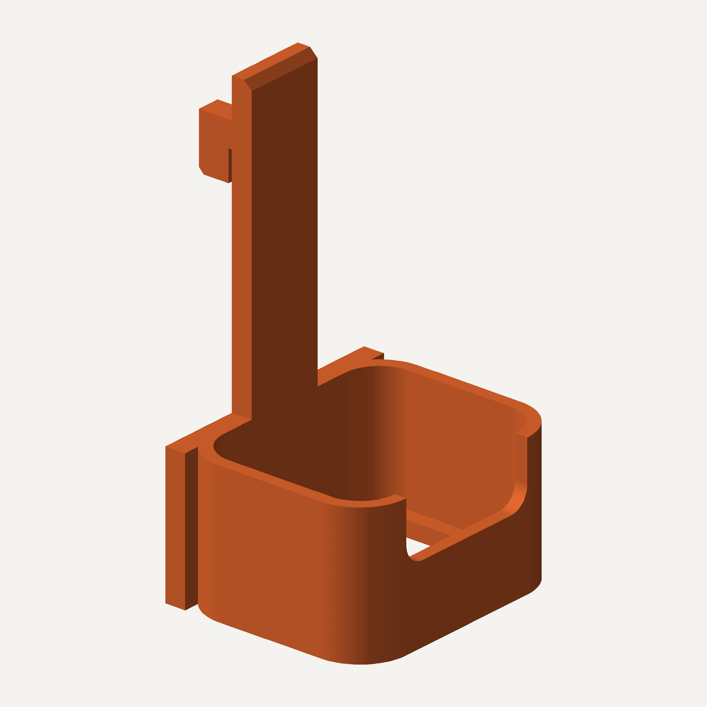

# Osmo Pocket 3 SKÅDIS Holder

SKÅDIS holder for a DJI Osmo Pocket 3 that can charge while it's stored: it stands gimbal-up in a cup on a 3 mm ledge round an open bottom, so a USB-C cable plugged into its underside hangs straight down through the hole.



> Not yet test-printed in this exact version.

## Files

- `pocket3_holder_JRJP-OP3-0003.3mf` - 3MF (open in your slicer)
- `pocket3_holder_JRJP-OP3-0003.stl` - STL
- `pocket3_holder.py` - source

## Print settings

- **Material:** PETG
- **Supports:** tree, build plate only (already set in the 3MF)
- **Orientation:** as exported
- **Notes:** Designed on a Snapmaker U1; the 3MF opens in Bambu Studio, OrcaSlicer and PrusaSlicer.

## Serial number

Each print carries an engraved serial number (JRJP-OP3-0003). The `SERIAL` setting at the top of the source controls it.

## Changing it

The model is generated by the Python script with [build123d](https://github.com/gumyr/build123d). Edit the numbers at the top and run it:

```bash
pip install build123d trimesh
python pocket3_holder.py
```

## License

[Creative Commons Attribution-NonCommercial-ShareAlike 4.0](https://creativecommons.org/licenses/by-nc-sa/4.0/)
