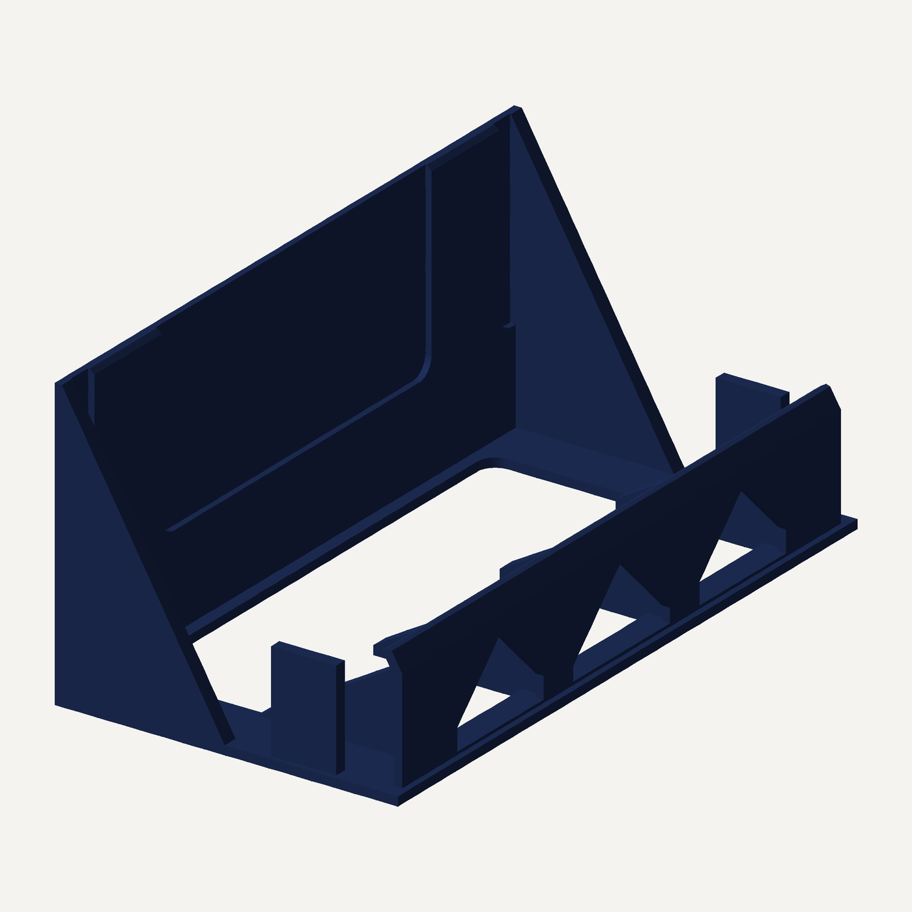

# P-touch H110 SKÅDIS Holder

SKÅDIS stand for the Brother P-touch PT-H110 label maker, lying on its side (a long edge down) with the keyboard and display facing out into the room.



> Not yet test-printed in this exact version.

## Files

- `ptouch_h110_holder_JRJP-PTH-0002.3mf` - 3MF (open in your slicer)
- `ptouch_h110_holder_JRJP-PTH-0002.stl` - STL
- `ptouch_h110_holder.py` - source

## Print settings

- **Material:** PETG
- **Supports:** tree, build plate only (already set in the 3MF)
- **Orientation:** as exported
- **Notes:** Designed on a Snapmaker U1; the 3MF opens in Bambu Studio, OrcaSlicer and PrusaSlicer.

## Serial number

Each print carries an engraved serial number (JRJP-PTH-0002). The `SERIAL` setting at the top of the source controls it.

## Changing it

The model is generated by the Python script with [build123d](https://github.com/gumyr/build123d). Edit the numbers at the top and run it:

```bash
pip install build123d trimesh
python ptouch_h110_holder.py
```

## License

[Creative Commons Attribution-NonCommercial-ShareAlike 4.0](https://creativecommons.org/licenses/by-nc-sa/4.0/)
