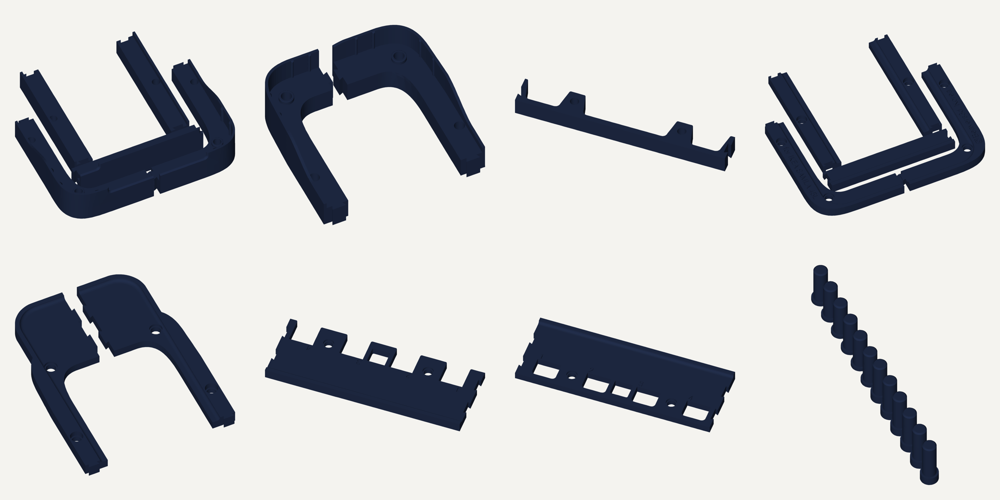

# Snapmaker U1 SAMLA 45L Top Cover (serial-engraved remix)

Beaver Works' Snapmaker U1 top cover for an IKEA SAMLA 45L box, with an engraved serial added.



The "No cable disconnecting" version of Beaver Works' top cover that turns an IKEA SAMLA 45 L box (art. 301.029.74, no lid needed) into an enclosure top for the Snapmaker U1. The only change is a serial number engraved into the underside of the rear upper piece. Each STL is one full plate.

> Not yet test-printed in this exact version.

## Files

- `parts/above_front_JRJP-SAM-0001.stl` - STL
- `parts/above_middle_JRJP-SAM-0001.stl` - STL
- `parts/above_rear_no_cable_disconnecting_JRJP-SAM-0001.stl` - STL
- `parts/pins_JRJP-SAM-0001.stl` - STL
- `parts/under_front_JRJP-SAM-0001.stl` - STL
- `parts/under_middle_JRJP-SAM-0001.stl` - STL
- `parts/under_rear_JRJP-SAM-0001.stl` - STL
- `samla_lid.py` - source

## Print settings

- **Material:** PETG
- **Orientation:** as exported
- **Notes:** Designed on a Snapmaker U1; the 3MF opens in Bambu Studio, OrcaSlicer and PrusaSlicer.

## Serial number

Each print carries an engraved serial number (JRJP-SAM-0001). The `SERIAL` setting at the top of the source controls it.

## Changing it

The model is generated by the Python script with [build123d](https://github.com/gumyr/build123d). Edit the numbers at the top and run it:

```bash
pip install build123d trimesh
python samla_lid.py
```

## Remix

Based on [Snapmaker U1 Top Cover Modding for IKEA SAMLA 45L](https://makerworld.com/en/models/2031310) by Beaver Works, licensed CC BY-NC-SA 4.0.

## License

[Creative Commons Attribution-NonCommercial-ShareAlike 4.0](https://creativecommons.org/licenses/by-nc-sa/4.0/)
